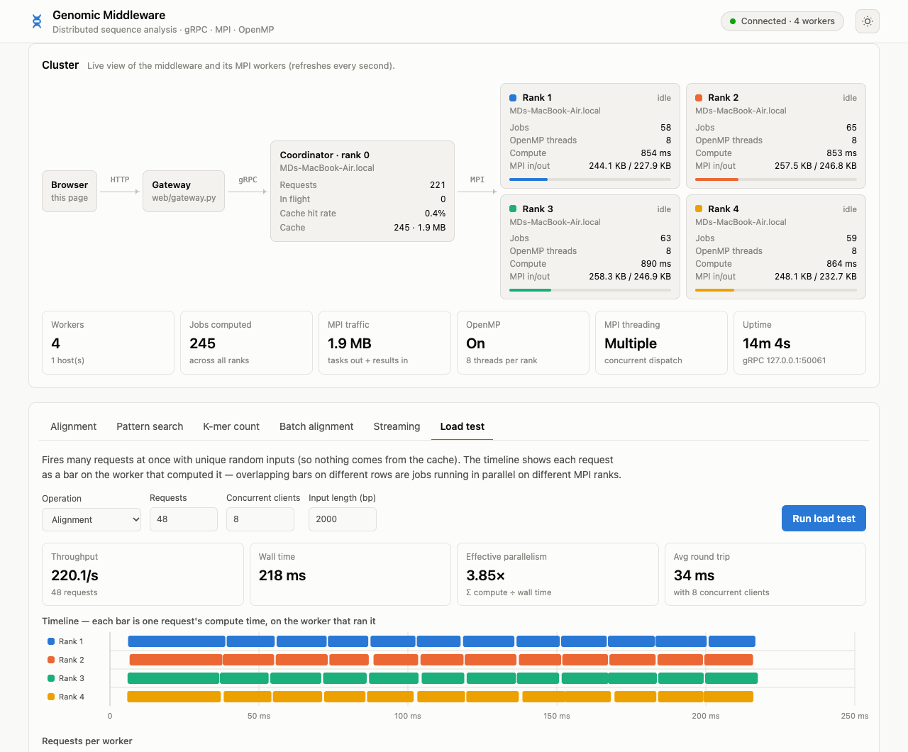

# Middleware for Distributed Genomic Sequence Analysis

**CSE-4269 Parallel and Distributed Systems Lab — Project (Roll 41)**

A middleware that sits between client applications and a cluster of worker processes. It accepts genomic analysis jobs over **gRPC**, distributes them to workers over **MPI**, runs the algorithms with **OpenMP** inside each worker, caches results, and reports live per-worker statistics. A **web dashboard** visualizes the whole pipeline.



## Quick start

```bash
# 1. Build (requires cmake, MPI, gRPC, protobuf, pkg-config; libomp on macOS for OpenMP)
cmake -S . -B build && cmake --build build -j

# 2. Python environment
python3 -m venv .venv && source .venv/bin/activate
pip install -r python/requirements.txt
./scripts/generate_grpc_python.sh

# 3. Start the middleware: 1 coordinator + 4 workers   (terminal 1)
mpirun -np 5 ./build/cpp/genomic_middleware --bind 0.0.0.0:50051

# 4. Start the web dashboard   (terminal 2) and open http://127.0.0.1:8080
./scripts/run_web.sh localhost:50051 8080

# ...or use the command-line client
python python/client.py --health
python python/client.py --align ACGTACGT ACGTTGCA
python python/client.py --stats
```

Helper scripts: `./scripts/run_middleware.sh [np] [--bind host:port]` (default 3 processes on `0.0.0.0:50051`) and `./scripts/run_web.sh [grpc_target] [http_port]`.

## Running on multiple machines

Every rank runs the same binary, so the cluster is whatever `mpirun` launches. To spread workers over several hosts (same build path on each, passwordless SSH between them):

```bash
# hosts.txt
node1 slots=1     # rank 0: coordinator (gRPC server)
node2 slots=2     # ranks 1-2: workers
node3 slots=2     # ranks 3-4: workers

mpirun --hostfile hosts.txt -np 5 -x OMP_NUM_THREADS=4 \
  ./build/cpp/genomic_middleware --bind 0.0.0.0:50051
```

Rank 0 lands on the first host, so clients connect to `node1:50051`. Each worker card in the dashboard (and `client.py --stats`) shows the worker's hostname, so you can confirm where the jobs ran.

## Features

| Concept | Where |
|---|---|
| **RPC (gRPC)** — clients submit alignment, pattern-search, k-mer and batch jobs | `proto/genomic.proto`, `cpp/src/server.cpp` |
| **MPI task distribution** — rank 0 dispatches each job to the next idle worker; many jobs run on different workers at the same time | `cpp/src/dispatch.cpp`, `cpp/src/worker.cpp` |
| **Scatter / gather** — `BatchAlignment` spreads one request's jobs over all workers and gathers the results in order | `server.cpp` (`BatchAlignment`) |
| **OpenMP** — intra-node parallelism: tiled wavefront Smith–Waterman, chunked KMP and k-mer counting | `cpp/src/algorithms/` |
| **Caching** — LRU cache (64 MB budget) of results; `cache_hit` reported in every response | `server.cpp` (`LruCache`) |
| **Observability** — every response says which MPI rank computed it and how long it took; `GetStats` reports per-worker load and MPI traffic | `JobInfo`, `GetStats` |
| **Streaming** — simulated sequencer sending chunks for near real-time k-mer statistics | `python/streaming_client.py`, dashboard *Streaming* tab |
| **Web dashboard** — live cluster view, workbench for every operation, load test with per-worker timeline | `web/` |

## Architecture

```
 Browser ──HTTP/JSON──▶ web/gateway.py ──gRPC──▶ Coordinator (MPI rank 0) ──MPI──▶ Workers (ranks 1..N)
 python/client.py ──────────────────────gRPC──▶   validate · LRU cache ·            Smith–Waterman / KMP / k-mer
                                                  idle-worker pool                   (OpenMP threads)
```

One binary runs every role: `main.cpp` starts MPI with `MPI_THREAD_MULTIPLE`, gathers each rank's hostname and OpenMP thread count, then rank 0 runs the gRPC server while ranks ≥ 1 run the worker loop.

**Request flow**

1. A gRPC handler (one of gRPC's thread pool) validates and normalises the input (whitespace stripped, upper-cased).
2. The request is serialised into a compact binary payload; that payload is also the cache key. A cache hit is answered immediately.
3. `dispatch_task` takes the next idle worker from a FIFO pool (blocking if all are busy) and sends **one** MPI message `[task type][payload]`.
4. The worker runs the algorithm and replies with **one** message `[status][compute µs][result]`. Receivers size buffers with `MPI_Mprobe`/`MPI_Mrecv`.
5. The worker returns to the idle pool, the result is cached, and the response carries `JobInfo{worker_rank, compute_ms, total_ms}`.

Because each worker is held by exactly one dispatching thread at a time, concurrent gRPC requests run on different workers in parallel. With `mpirun -np 1` there are no workers and jobs run inside the coordinator.

**Algorithms**

- **Smith–Waterman** (linear gap penalty). For ≥ 1M matrix cells the DP matrix is cut into 256×256 tiles; tiles on the same anti-diagonal are independent and are filled in parallel (wavefront).
- **KMP**. Texts ≥ 1 Mbp are split into blocks of start positions, one per thread; each block scans `len(pattern) − 1` characters past its end so no match is lost.
- **K-mer counting** (k ≤ 32). Each k-mer is packed 2 bits/base into a `uint64` updated as the window slides; non-ACGT characters reset the window. Inputs ≥ 256 kbp are split across threads.

## Project structure

```
├── proto/genomic.proto          # gRPC service: 4 analysis RPCs + HealthCheck + GetStats
├── cpp/
│   ├── CMakeLists.txt           # targets: genomic_core, genomic_proto, genomic_middleware, algorithms_test
│   ├── src/
│   │   ├── main.cpp             # MPI init; rank 0 = coordinator, ranks ≥ 1 = workers
│   │   ├── server.cpp/hpp       # gRPC service, validation, LRU cache, batch scatter/gather, stats
│   │   ├── dispatch.cpp/hpp     # idle-worker pool, MPI round trip, per-worker counters
│   │   ├── worker.cpp/hpp       # worker loop + execute_task (shared with local mode)
│   │   ├── mpi_protocol.*       # binary task/result encoding and MPI message framing
│   │   └── algorithms/          # smith_waterman, kmp, kmer (serial + OpenMP paths)
│   └── tests/algorithms_test.cpp
├── python/
│   ├── client.py                # CLI: health, stats, align, pattern, kmer, batch
│   ├── streaming_client.py      # simulated sequencer
│   ├── visualize.py             # matplotlib k-mer chart
│   └── genomic_pb2*.py          # generated stubs (checked in)
├── web/
│   ├── gateway.py               # HTTP/JSON → gRPC gateway, serves the dashboard
│   └── static/                  # index.html, app.js, style.css
├── scripts/                     # run_middleware.sh, run_web.sh, generate_grpc_python.sh
├── data/sample.fasta            # small FASTA used by the dashboard's "Sample FASTA" buttons
└── docs/dashboard.png
```

## Web dashboard

`web/gateway.py` is a small standard-library HTTP server (browsers can't speak native gRPC) that serves `web/static/` and translates JSON calls to gRPC. No CDN or build step — it works offline.

- **Cluster** — topology, each worker's state (idle / running), jobs, compute time, MPI bytes, cache hit rate; refreshes every second.
- **Alignment / Pattern search / K-mer count** — run a job and see the result (colour-coded alignment, highlighted matches, k-mer histogram) plus which rank computed it.
- **Batch alignment** — compare wall time with the sum of compute time (effective parallelism).
- **Streaming** — simulated sequencer; watch chunks land on different workers.
- **Load test** — fire N concurrent requests and see a per-worker timeline of when each job ran.
- **Activity** — every request with worker, cache status and timings.

Options: `python web/gateway.py --grpc HOST:PORT --host 0.0.0.0 --port 8080`.

## Command-line clients

```bash
cd python
python client.py --health
python client.py --stats
python client.py --align ACGTACGT ACGTTGCA
python client.py --pattern "ACGTACGTACGTACGT" ACGT
python client.py --kmer ACGTACGTACGTACGT 3
python client.py --batch REFSEQ SEQ1 SEQ2 SEQ3          # each SEQ aligned against REFSEQ
python streaming_client.py --chunks 10 --chunk-size 500 --k 4 --delay 0.2
python visualize.py --sequence "ACGTACGTACGTACGT" --k 3 --out kmers.png
```

All accept `--host` / `--port` (default `localhost:50051`).

From your own Python code:

```python
import grpc, genomic_pb2 as pb, genomic_pb2_grpc as pbg

stub = pbg.GenomicServiceStub(grpc.insecure_channel("localhost:50051"))
r = stub.BatchAlignment(pb.BatchAlignmentRequest(reference="ACGTACGT", sequences=["ACGTTCGT", "ACGAACGT"]))
for x in r.results:
    print(x.score, x.aligned_a, x.aligned_b, "rank", x.info.worker_rank)
```

## Sample data

`data/sample.fasta` holds four short sequences (`seq1`, `seq2`, `seq3`, `ref`). The dashboard's **Sample FASTA** buttons load it (via `/api/sample`), and the Batch tab accepts pasted FASTA directly. The dashboard can also generate random inputs (up to 2 Mbp) for larger tests.

## API notes

- `SequenceAlignment`: if `match_score`, `mismatch_penalty` and `gap_penalty` are all 0 (unset), defaults 2 / −1 / −1 are used. `match_score` must be positive.
- `BatchAlignment`: either `reference` + `sequences` (each aligned to the reference) or, with no reference, an even number of `sequences` aligned as pairs (0–1, 2–3, …).
- Limits (→ `INVALID_ARGUMENT`): k in 1..32; non-empty pattern; sequences ≤ 20 Mbp; `len(a) × len(b)` ≤ 25 M cells for alignment; messages ≤ 64 MB.

## Tests

```bash
cmake --build build && ./build/cpp/algorithms_test      # or: ctest --test-dir build
```

Checks every algorithm against a brute-force reference (including inputs large enough to take the OpenMP paths, and serial-vs-parallel Smith–Waterman equality) and the MPI wire format (round-trips and rejection of truncated messages).

## Requirements

- **C++**: CMake ≥ 3.16, C++17, MPI (Open MPI / MPICH, ideally with `MPI_THREAD_MULTIPLE`), Protobuf, gRPC, pkg-config; OpenMP optional.
- **Python**: 3.9+, packages in `python/requirements.txt`.

macOS (Homebrew):

```bash
brew install cmake open-mpi grpc protobuf pkg-config libomp
```

CMake locates Homebrew's `libomp` automatically; the configure output says `OpenMP enabled` when it is found.

## Performance notes

- Builds default to `Release`.
- Measured on one laptop, 4 workers, 32 alignments of 1,500 × 1,500 bp from 16 concurrent clients: **104 jobs/s** with the original global-lock dispatcher vs **331 jobs/s** after the rework (worker pool + OpenMP wavefront).
- More workers help concurrent and batch workloads; OpenMP helps individual large jobs. On a single machine, ranks and OpenMP threads share the same cores — set `OMP_NUM_THREADS` (e.g. `mpirun -np 5 -x OMP_NUM_THREADS=2 …`) to avoid oversubscription.
- Repeated identical requests return `cache_hit=true` without touching a worker.

## Changes from the first version

Bugs found and fixed:

- **KMP missed matches that end at the last character** (`AACGT` / `ACGT` found 0 matches; `AAAA` / `AA` found 2 of 3) — the scan stopped `len(pattern) − 1` characters early.
- **OpenMP was never enabled** — CMake didn't find Homebrew's libomp with Apple Clang, so all OpenMP code was dead. Once enabled, the k-mer OpenMP path didn't compile (missing `<vector>`) and its overlapping chunks double-counted k-mers at boundaries.
- **Only one worker ever ran at a time** — a global mutex wrapped every dispatch, so concurrent clients were serialised. Replaced with an idle-worker pool on `MPI_THREAD_MULTIPLE` (3.2× throughput with 4 workers).
- **`BatchAlignment` ran sequentially** and skipped the cache; it now scatters jobs over all workers.
- **Builds had no optimisation** (`-O0`, no build type) — now `Release` by default.
- Smith–Waterman's header promised OpenMP but the code was serial; it now uses a tiled wavefront.
- Unchecked parsing (truncated MPI messages were read as valid), no input validation (unbounded alignment memory), and a cache that evicted arbitrary entries by count.

Added: unit tests, per-job worker/timing info, `GetStats`, one-message MPI framing, the LRU cache with a byte budget, CLI `--stats` / `--batch`, and the web dashboard.

## Troubleshooting

**`VersionError: Detected mismatched Protobuf Gencode/Runtime major versions`** — the stubs were generated with a different Protobuf major version than the one installed (e.g. Anaconda base). Use the project venv, or regenerate the stubs in your environment with `./scripts/generate_grpc_python.sh`.

**Dashboard says "Middleware offline"** — the gateway is up but can't reach gRPC; check the `--grpc` address and that `mpirun` is running.

**`warning: MPI_THREAD_MULTIPLE not available`** — your MPI build lacks full thread support; the middleware still works but dispatches one job at a time.

## License

For use in CSE-4269 course context only.
